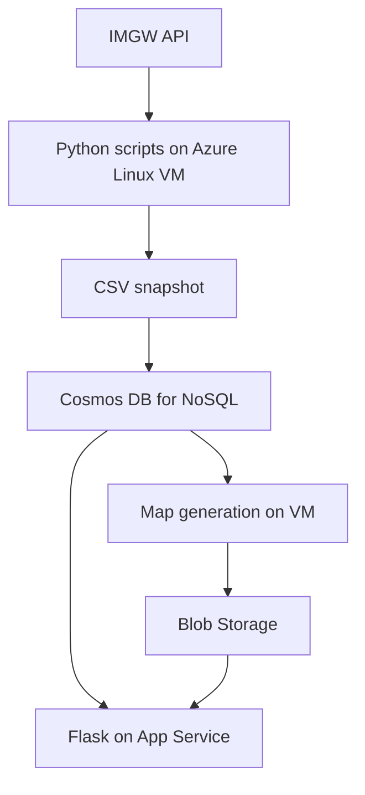
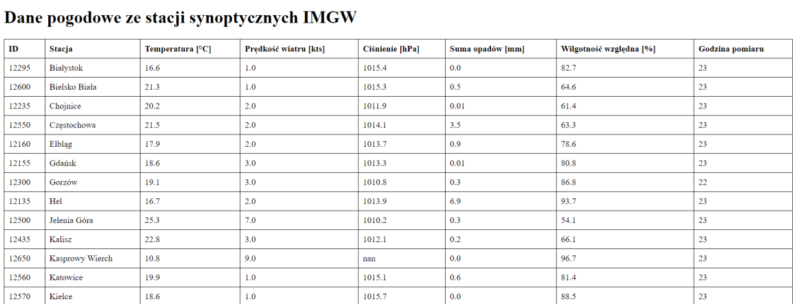
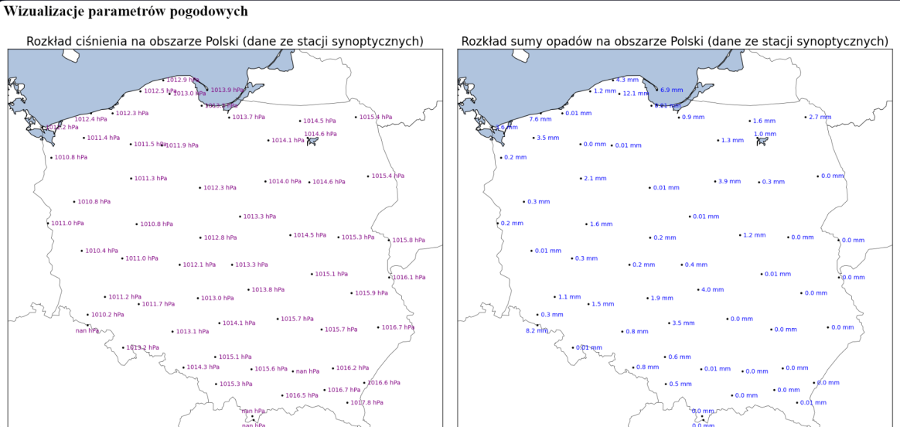

# Azure IMGW Weather Pipeline

**An academic Python and Microsoft Azure project for collecting, storing and visualising weather observations from synoptic stations across Poland.**

The full system described in the project report combined an Azure Linux VM, Cosmos DB for NoSQL, Blob Storage and a Flask application hosted on App Service. This repository contains the recovered **data collection, database loading and map generation scripts**, the **Flask web application**, HTML templates and static assets. The original App Service deployment workflow is preserved as an inactive example; Blob upload and cron configuration are still missing.

**Project implementation:** Jakub Maciejak  
**Course:** Cloud Processing of Large-Scale Data, Geoinformatics, Wrocław University of Science and Technology  
**Project report submitted:** 19 June 2024

[Jakub's GitHub](https://github.com/Maciejuu) · [LinkedIn](https://www.linkedin.com/in/jakub-maciejak-3aa280277/)

## Objective

Build a workflow that retrieves IMGW observations, adds location information, updates a cloud database and generates weather maps. The documented web application displayed a station table and maps of temperature, pressure, precipitation and relative humidity.

This is a small educational cloud integration project. The supplied scripts process a station snapshot; they do not implement distributed processing or a historical observation archive.

## Technologies

- **Python:** Requests, Pandas and Geopy for data collection and preparation.
- **Azure Cosmos DB for NoSQL:** station documents and updates through the Azure Cosmos Python SDK.
- **Matplotlib / Basemap:** static maps with station values and labels.
- **Linux and cron:** scheduled processing on an Azure VM, as documented in the report.
- **Azure Blob Storage and Azure CLI:** publication of map images in the original deployment.
- **Flask and Azure App Service:** station table and map presentation, with recovered application source and an archived deployment workflow.

## Architecture



The diagram describes the original documented system. Blob upload and scheduling require files or configuration that have not been recovered.

## Included scripts

| File | Function |
|---|---|
| [`src/imgw_api.py`](src/imgw_api.py) | Requests synoptic observations, excludes the `Platforma` record, geocodes station locality names using ArcGIS with Nominatim fallback, and saves `imgw_data.csv`. |
| [`src/make_database.py`](src/make_database.py) | Reads the CSV, creates a database/container if absent, and inserts or replaces station documents in Cosmos DB. |
| [`src/maps_create.py`](src/maps_create.py) | Reads station documents from Cosmos DB and creates four PNG maps with Basemap and Matplotlib. |

The recovered Flask application is in [`webapp/app.py`](webapp/app.py), with its template in [`webapp/templates/index.html`](webapp/templates/index.html). It queries Cosmos DB, lists PNG blobs and passes their URLs to the template.

These are copies of the supplied scripts and application files, without functional changes. Dependencies and configuration examples were added for repository documentation; they are not recovered deployment files.

## Data flow

1. Retrieve JSON from the [public IMGW synoptic API](https://danepubliczne.imgw.pl/api/data/synop/).
2. Convert the records to a Pandas DataFrame and add latitude/longitude through locality geocoding.
3. Write a CSV snapshot to the current working directory.
4. Use the station ID as the Cosmos document ID and `weather` as the value of `/partitionKey`.
5. Replace an existing document or create a new document if it is absent.
6. Read documents from Cosmos DB, convert selected fields to numeric values and render station maps.
7. In the original deployment, upload maps to Blob Storage and display them through the web application.

### Scheduling in the report

| Minute of each hour | Documented task |
|---|---|
| 20 | Collect API data. |
| 25 | Update Cosmos DB. |
| 27 | Generate maps. |
| 30 | Upload images to Blob Storage. |

These are historical scheduling choices, not an included crontab or a recommended guarantee of task completion. The scripts have no dependency-aware scheduler or protection against overlapping runs.

## Results and example outputs

The report describes a deployed website with a station table and four weather maps. One database screenshot recorded **51 station documents** at that point in the project. This is a historical observation, not a fixed station count or a guarantee of current API coverage.

The supplied map script writes:

- `mapy/temperatura.png` — temperature;
- `mapy/cisnienie.png` — atmospheric pressure;
- `mapy/suma_opadu.png` — precipitation;
- `mapy/wilgotnosc_wzgledna.png` — relative humidity.

The maps label individual station observations. They do not interpolate a continuous weather surface. The Polish labels in the original outputs and source code are retained.

**Station table from the original report**



**Map presentation from the original report**



A deployment issue documented in the report was a failed App Service connection to Cosmos DB. The team inspected application logs and updated the Cosmos DB firewall allowlist to permit the application connection.

## Repository structure

| Path | Contents |
|---|---|
| `README.md` | Project description, status and setup outline. |
| `src/` | Three recovered Python pipeline scripts. |
| `webapp/` | Flask application, its original dependency list, templates and static assets. |
| `docs/deployment/original-app-service-workflow.yml.example` | Original GitHub Actions deployment configuration, stored as an inactive reference. |
| `requirements.txt` | Unpinned dependencies inferred from script imports; not a tested environment lockfile. |
| `.env.example` | Placeholder Cosmos DB settings. |
| `.gitignore` | Excludes credentials, generated data, logs and local environments. |
| `assets/` | Historical output screenshots extracted from the report. |
| [`docs/recovery-checklist.md`](docs/recovery-checklist.md) | Missing components and recommended fixes before rerunning. |

The original Polish report, `sprawozdanie_projekt_maciejak_hajski.pdf`, can be added to `docs/` after checking its Azure screenshots for information that should not be published. It is not bundled here.

## Setup outline

### Prerequisites

- Python with the packages listed in `requirements.txt`; their compatible versions must be verified.
- An Azure Cosmos DB for NoSQL account and permission to access the selected database/container.
- Network access to IMGW, the configured geocoders and Cosmos DB.
- A compatible Basemap installation for the mapping stage.

Creating Azure resources or running scripts against a real account can incur charges. The database script requests **1,000 RU/s when creating a container**; review the intended account configuration before running it.

### Prepare a local environment

From the repository root on Linux:

```bash
python3 -m venv .venv
source .venv/bin/activate
python -m pip install -r requirements.txt
mkdir -p mapy
```

Use `.env.example` as a reference for configuring these variables:

| Variable | Purpose |
|---|---|
| `COSMOS_URL` | Cosmos DB account endpoint. |
| `COSMOS_KEY` | Account credential. |
| `COSMOS_DATABASENAME` | Target database name. |
| `COSMOS_CONTAINER_NAME` | Target container name. |

**The original scripts use `os.getenv`; they do not load `.env` files automatically.** Export the variables in the shell or configure them in the environment that starts Python. A local `.env` file alone will not configure the scripts.

### Execution order

After addressing the mapping issue and configuration checks below, run from the repository root:

```bash
python src/imgw_api.py
python src/make_database.py
python src/maps_create.py
```

The scripts use paths relative to the current working directory. The first two share `imgw_data.csv`; the map script expects the `mapy/` directory to exist.

These steps are an execution outline, not a verified deployment procedure. The pipeline was not rerun against live services while preparing this repository.

### Flask application

The web application has a separate dependency list: `webapp/requirements.txt`. The original version pins have been preserved and their compatibility has not been verified. Use a separate virtual environment if testing the web layer.

Configure `COSMOS_URL`, `COSMOS_KEY`, `COSMOS_CONTAINER_NAME` and the following application-specific settings:

| Variable | Purpose |
|---|---|
| `COSMOS_DATABASE_NAME` | Same database as pipeline variable `COSMOS_DATABASENAME`, but with a different variable name. |
| `STORAGE_CONNECTION_STRING` | Blob Storage credential/connection string. |
| `STORAGE_CONTAINER_NAME` | Container holding the PNG maps. |

The application embeds direct blob URLs in HTML. The browser must be able to read those images; the application does not generate SAS URLs or proxy the image bytes. A storage connection string used by the server alone does not grant browser access.

For local testing after configuring credentials and installing the web dependencies, run from `webapp/`:

```bash
python -m flask --app app run
```

A possible Linux WSGI startup command, run from `webapp/`, is `gunicorn --bind 0.0.0.0:8000 app:app`; this is a suggested entry point, not a recovered App Service startup setting.

The original workflow targeted the `master` branch and the `polishweather` App Service. It is retained in `docs/deployment/` with a `.example` suffix so adding the files to GitHub does not activate deployment. Review action versions, dependency compatibility, deployment packaging, application path and secret references before adapting it.

## Known limitations and required fixes

- **Map display call:** `plt.show(bbox_inches='tight')` passes a save-related argument to `show`. Before running, move `bbox_inches='tight'` to `plt.savefig(...)` and remove the display call for a headless VM. The supplied script was retained unchanged.
- **Time handling:** the collection script adds a fixed `+2` to the observation hour. It does not handle daylight-saving changes, midnight rollover or date updates. The database document also omits the API's observation date.
- **Geocoding:** locality coordinates are not surveyed station coordinates. Repeated geocoding is uncached and may be affected by availability or provider usage limits.
- **Request handling:** the IMGW request has no explicit timeout, status check or retry policy.
- **Missing data:** direct float conversion and strict dropping of Cosmos metadata fields can fail for unexpected records; numeric values are stored as strings, including possible `nan` text.
- **Snapshot model:** records are updated by station ID, so the implementation does not retain observation history or remove stations absent from a later API response.
- **Partitioning:** all documents share `weather`; this is a simple educational design and has not been evaluated for larger workloads.
- **Flask route:** `/mapy/<image_name>` calls `redirect` without importing it. Add the Flask import before using that route. The home page uses direct blob URLs instead.
- **UI units:** the original template labels wind speed as `kts`, while the ingestion code performs no wind-unit conversion. Verify the upstream unit and correct the label before publishing.
- **Application settings:** pipeline scripts use `COSMOS_DATABASENAME`, whereas Flask uses `COSMOS_DATABASE_NAME`; configure both consistently.
- **Deployment gaps:** the Blob upload script, cron entries and infrastructure definitions are missing. An archived App Service workflow is included but has not been validated for a new repository.


## Next steps

Recover the Blob upload script and cron configuration; review the recovered Flask application and deployment workflow; replace fixed-hour arithmetic with timezone-aware timestamps; validate input types; cache station locations; add request error handling and logging; verify dependencies; and consider observation-history storage if required.

## Authorship

Jakub Maciejak implemented the complete solution, including the Python scripts and Azure service integration. The original academic report lists Jakub Maciejak and Rafał Hajski as its authors; implementation attribution here follows Jakub’s clarification.

## Project status

**Recovered academic prototype / partial source archive.** The report documents the original deployment. The supplied scripts and Flask application have been inspected statically but have not been executed against live API, geocoding or Azure services for this repository preparation. Screenshots are historical results from the report, not newly generated outputs.
